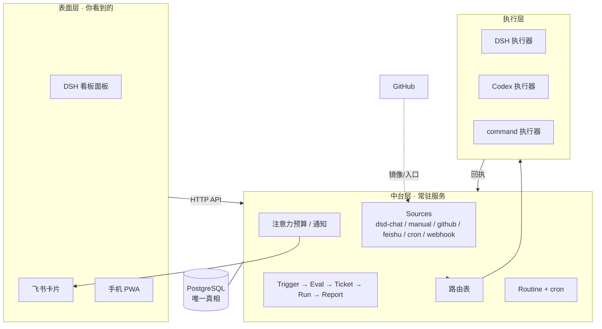
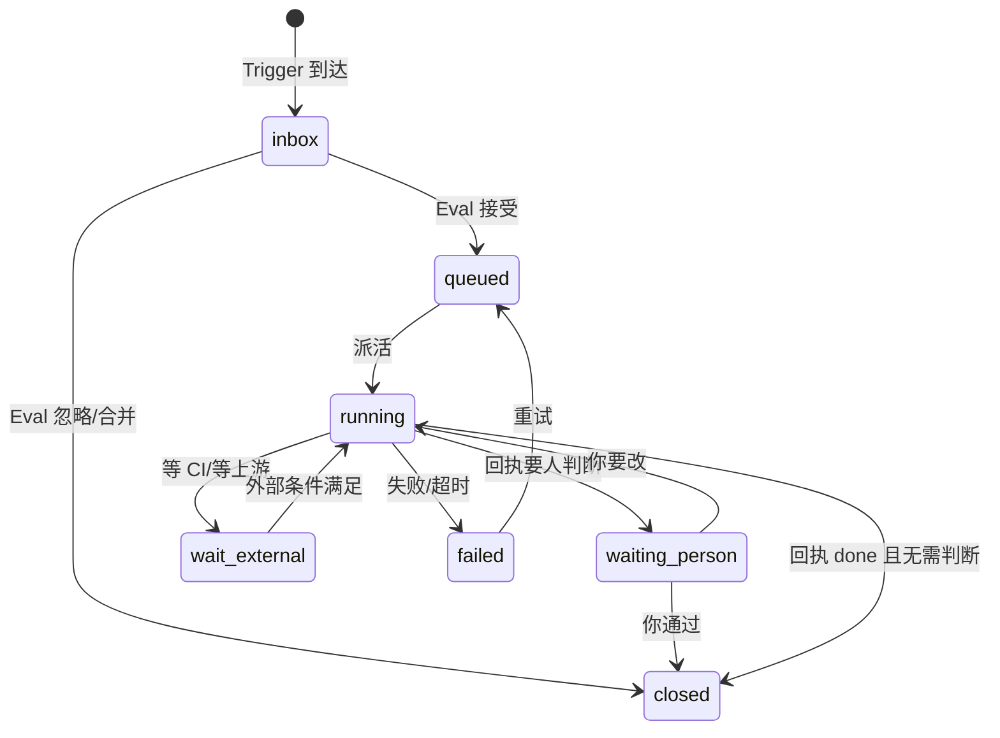
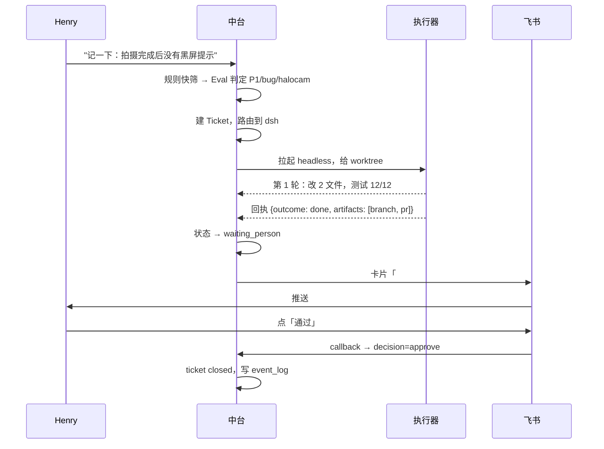

# SuperAgent 工作看板 · 设计评审稿 v0.1

> 2026-11-13 · 供 Henry 评审。评审通过后再写代码。
> 配套可点原型：[`prototype.html`](prototype.html)（假数据，含一条反馈的完整动线）

---

## 0. 一页结论

**它是什么**：一个常驻在你这台 Mac 上的「派活中台」。把 DSH 会话、GitHub issue、飞书群、定时器里的反馈收成 **Ticket**，按规则派给某个执行器（DSH 或 Codex）去跑，跑完只把「必须你拍板的事」推到你面前。你不开电脑它也在转。

**它不是什么**：不是又一个聊天窗口；不是 GitHub issue 的皮肤；不是自动化任务的替代品——自动化任务是它的一种触发器。

**四个需要你拍板的决策**（我的推荐已标注）：

| # | 决策 | 推荐 | 代价 |
| --- | --- | --- | --- |
| D1 | 中台是独立常驻服务，还是继续做 DSH 插件进程内的一部分？ | **独立 Node 服务**（PG 唯一真相），DSH 只负责 UI | 多一个 launchd 进程 |
| D2 | 重写薄内核，还是把 dsh-superagent 原型引擎改成 PG？ | **重写薄内核**，只抄它的领域模型和提示词分层 | 约 1500 行新代码，但省掉一次大手术 |
| D3 | Codex 怎么接？ | **`codex exec` 非交互 + 每次独立 git worktree** | 无审批交互，必须靠沙箱+白名单 |
| D4 | 旧「工作看板」插件怎么处理？ | **降级为 HaloCam 项目视图**，一期与新版只读并行 | 两套界面并存约 2 周 |

**一期做完你能看到的样子**（可验收）：
1. 你在 DSH 里说「记一下：拍摄完成后没有黑屏提示」→ 30 秒内看板上出现一张卡，标着「等你判断 / P1 / 派给 DSH」。
2. 手机飞书群里收到一张卡片：「#72 已修好，分支 `fix/black-flash`，测试 12/12，通过？」三个按钮可直接点。
3. 每天早上 08:00 那两条固定流程（日记教练、SG 巡检）自动跑，正常不吵你，WARN 才推。

**工作量**：P0 骨架 3–4 天，P1 一期闭环 5–7 天，P2 打磨 3–5 天（都是 AI 执行、你只做评审与验收的节奏）。

---

## 1. 为什么现在这套不够用

不是「功能少」，是三处结构性失效：

| 失效点 | 现在的样子 | 后果 |
| --- | --- | --- |
| **起点在人身上** | 你得打开 DSH 或 Codex 窗口，活才开始 | 你能同时推进的，永远是你盯得过来的那 3–5 个窗口 |
| **状态分裂** | GitHub 是需求真相，引擎里有 `blocked/running`，看板又是第三份展示 | 你已经踩过：issue 已关闭并验收通过，看板仍显示「待处理」 |
| **只有「你说话」一条输入** | 反馈靠你复述给某个窗口，或让 grokbot 去提 issue | 群里、截图里、脑子里闪过的想法，没有低成本落点 |

上一版工作看板修好了「展示」和「就地操作」，但没有修「起点」。这一版修的是起点。

---

## 2. 架构总览

四层，**每层对上层不可见**——这是你定的原则，也是整套设计的地基。上层只知道「我要一个结果和证据」，不知道下层用了什么模型、什么技能、什么高效开发模式。



**常驻形态**：一个 Node 服务（launchd 保活），监听 `127.0.0.1:8790`，外面套一层反代处理公网 webhook。看板是它的客户端，不是它的宿主。

> 为什么不继续用 DSH 插件进程内跑（D1）：原型的 HTTP 层强制 loopback 且同源、状态目录有单进程文件锁、插件重启即丢内存态、接不了公网 webhook。把它当服务跑，等于跟宿主打架。

---

## 3. 领域模型

### 3.1 概念

| 概念 | 一句话 | 关键规则 |
| --- | --- | --- |
| **Project** | 一个代码库或一个生活域 | HaloCam / 博客 / 研究 / 基建；决定可用的执行器和路由 |
| **Source** | 一个入站流（可多实例） | 记住自己的游标；同一 kind 可开多个实例（HaloCam 和博客两个 GitHub 仓库） |
| **Trigger** | 一条不可变的事件 | 带去重键；重复到达不产生第二张 Ticket |
| **Ticket** | 一个被授权的工作单元 | 只由 Eval 创建；**一个 Ticket 永远只绑一个执行器**；可改派（旧 run 作废） |
| **Run** | 一次执行尝试 | Ticket 可有多次 run；run 的状态不决定 ticket 的状态 |
| **Report** | run 结束时的结构化回执 | 见 §6.4；是系统唯一的「事实来源」 |
| **Decision** | 一次需要人或规则拍板的判断 | 人答、规则答、超时默认；都可审计 |
| **Routine** | 一段可复用的固定流程 | 版本化文档 + 状态目录 + 幂等账本 + 产出通道 + 升级规则 |
| **Schedule** | cron 表达式 | 只是「什么时候唤醒一条 Routine」；不持有业务状态 |
| **Artifact** | 产物或大块上下文 | 分支、PR、截图、长文全文；本地文件 + PG 索引 |

### 3.2 Ticket 状态机（内部 7 态，界面 4 桶）



界面只映射 4 个桶，避免你面对 7 个状态词：

| 桶 | 内部状态 | 你要做什么 |
| --- | --- | --- |
| **等你判断** | `waiting_person` / `failed` | 只有这里需要你动手 |
| **正在跑** | `running` | 什么都不用做 |
| **排队中** | `inbox`（等你没看见）/ `queued` / `wait_external` | 什么都不用做 |
| **已结束** | `closed` | 只看结果 |

### 3.3 PG 表（13 张）

```
project(id, name, root, repos[], allowed_executors[], policy)
source(id, project, kind, config jsonb, cursor jsonb, enabled, health)
trigger(id, source, project, external_id, dedupe_key, actor, at, raw jsonb, disposition)
ticket(id, project, title, body, kind, priority, state, executor, executor_override,
       mandate jsonb, origin_trigger, thread_key, created_at, updated_at)
run(id, ticket, executor, attempt, workspace, session_ref, state, started_at, ended_at,
    usage jsonb, report jsonb)
decision(id, ticket, run, kind, question, options jsonb, recommended,
         answered_by, answered_at, channel, choice, restatement, audio_ref)
artifact(id, ticket, run, kind, path, url, sha256, bytes, summary, expires_at)
routine(id, project, name, cron, tz, instruction_ref, instruction_sha, executor,
        state_dir, idem_key_pattern, outputs jsonb, escalation jsonb, enabled, last_run, next_run)
schedule(id, routine, next_at, last_fired_at, skipped)
outbox(id, ticket, channel, ref, payload, state, tries, next_at)
receipt(id, run, body jsonb, verified_at)
event_log(id, at, entity, entity_id, kind, payload jsonb)   -- 审计与回放
```

`trigger.dedupe_key` 是幂等的唯一支点：同一 GitHub comment id、同一飞书 message id、同一 `routine@时间槽`，重复到达直接落 `disposition=duplicate`，不进 Eval。

---

## 4. 触发：5 个入口 + 1 个时钟

| 入口 | 延迟 | 幂等键 | 一期 |
| --- | --- | --- | --- |
| **DSH 会话** | 即时（工具调用直写） | 会话 id + 消息 id | ✅ |
| **看板/手机输入框** | 即时 | 客户端生成 uuid | ✅ |
| **GitHub issue/comment** | 5 分钟轮询（webhook 可选，降到秒级） | `repo#number:updated_at` | ✅ |
| **飞书群 @机器人** | 即时（长连接） | 飞书 message_id | ✅ |
| **定时器** | 到点 | `routine_id@YYYY-MM-DDTHH:mm` | ✅ |
| **通用 webhook** | 即时 | 源自定义 | 预留（小红书群走这里） |

**关于「5～10 分钟」**：push 类入口（DSH、飞书、webhook）本来就是秒级；GitHub 走 5 分钟轮询就够——issue 上的反馈不是股票行情。真正的瓶颈是**评估**，见下节。

**DSH 会话那条怎么写进去**：在 DSH 里加一个工具 `board_note(title, body?, links?, project?)`。你说「记一下：xxx」它就直接落库，不等你确认；落库后看板上 1 秒内出现一张卡。这条路径不经过 LLM 评估（你说的就是需求），只做项目归类和去重。

---

## 5. 评估（Eval）：两段式，省 token 也降延迟

原型是「每条 trigger 都过一次 LLM 评估」，成本随消息线性涨。我们改成两段：

**第一段 · 规则快筛（毫秒级，确定性代码）**
- 去重键命中 → `duplicate`
- 发送者在允许名单外 → `filtered`
- 命中静音规则（例如 CI 机器人、`[skip]` 前缀）→ `filtered`
- 同 `thread_key` 5 分钟内已有 open ticket → `merged`（把 trigger 挂上去，不再建票）

**第二段 · LLM 判定（只对活下来的）**
输入：该 trigger + 同 thread 最近 5 条 + 该 thread 上所有 ticket（含已结束）+ 项目策略。
输出（结构化 JSON，不是自由文本）：
```json
{"decision":"accept|merge|ignore|ask","priority":"P0|P1|P2|P3",
 "kind":"bug|feature|chore|question","executor_hint":"dsh|codex",
 "title":"...","scope":"...","needs_context":["artifact:..."],"reason":"一句话"}
```
`ask` 是「我判断不了，问他」——但**只在真的判断不了时用**，否则会变成第二种打扰。

**批量窗口**：同一 thread 在 5 分钟内的多条 trigger 合并成一次评估（对齐原型的 batch 语义），避免你在群里连发三条就触发三次判断。

**成本闸门**：每个项目每天评估次数上限（默认 200），超了降级为规则快筛 + 进看板等你手动判定。

---

## 6. 派活：路由 + 执行器 + 回执

### 6.1 路由表（你说「按任务类型自动路由，可覆盖」）

```yaml
routes:
  - when: {project: halocam, kind: bug,  priority: P1}   → codex   # 长链条 Android 改动
  - when: {project: halocam, kind: bug}                   → dsh
  - when: {project: blog,    kind: chore}                 → dsh
  - when: {kind: research}                                → dsh     # 调研类，DSH 更自由
  - default                                               → dsh
```

- 命中多条取第一条；没命中走 default。
- 看板上每个任务有一个「改派」下拉，改了写 `ticket.executor_override`，下一轮 run 用新执行器，旧 run 作废但保留记录。
- 执行器自身能力写在 `capabilities` 里（能否交互、沙箱级别、最大轮次），路由时校验：派给 `command` 的任务不能要求交互。

**为什么默认 DSH**：你有预设、有 hooks、有 skills、有高效开发模式——那是你调好的工作台。Codex 用在「需要长时间独立实现、且我这边不方便挂会话」的场景。

### 6.2 执行器接口（三个实现）

```ts
interface Executor {
  kind: 'dsh' | 'codex' | 'command'
  capabilities: { interactive: boolean; sandbox: 'read'|'write'|'full'; maxTurns: number }
  prepare(t: Ticket): Promise<RunPlan>   // 工作目录、分支、环境变量、预算
  start(p: RunPlan): Promise<RunHandle>  // 拉起进程/会话
  stop(h: RunHandle, reason: string): Promise<void>
  collect(h: RunHandle): Promise<Report> // 退出码 + 最后一段输出里的回执
}
```

| 执行器 | 怎么跑（已在你这台机器上核实） | 隔离 | 备注 |
| --- | --- | --- | --- |
| **dsh** | `dsh headless "<任务书>"` —— 走你已有的 `~/.dsh/profiles/headless` profile；等价启动命令 `node --import tsx/esm <checkout>/apps/cli/src/bin.ts headless "<任务书>"` | 每票一个 `git worktree` | 复用你的 preset / skills / 高效开发模式；非交互、跑完打印结果即退出 |
| **codex** | `codex exec --json -o <文件> "<任务书>"`，沙箱用 `-s <mode>` | 每票一个 worktree | `--json` 给事件流，`-o` 给最后一条消息（回执就从这里读）；**不用** `--dangerously-bypass` |
| **command** | 直接跑脚本，退出码即结论 | 无 | 给「跑个巡检脚本」这类流程用 |

**隔离规则**：一个 Ticket 一个 worktree，路径 `~/.superagent/work/<ticket-id>`；跑完保留，你验收后由清理任务回收（保留 14 天）。绝不在你的工作目录里直接改。

**已验证的原始命令**（今天在这台机器上真跑通的，不是推测）：

```bash
# ① DSH：无人值守、只打印答案
dsh headless --permission-mode read-only --approval-policy never "回答三个字符：ok1"
# → ok1

# ② Codex：非交互、最后一条消息落文件
codex exec -s read-only --skip-git-repo-check -o /tmp/last.txt "只回答三个字符：ok2"
# → /tmp/last.txt 内容是 ok2
```

> 顺带修好的坑：这台机器原来没有 `dsh` 命令。现在 `/Users/dpdu/Desktop/bin/dsh` 是一个 wrapper（等价 `pnpm dsh`），并软链到 `~/.local/bin/dsh` 进了 PATH。它必须给 tsx 指认仓库的 `tsconfig.json`，否则在别的目录下会解析到旧构建产物、报 `FiberState` 不存在。

**并发**：默认同时 3 个 run，每个执行器 2 个；超出的排队。这是保护你机器的内存，也是保护「一次只改一处代码」的确定性。

### 6.3 一次派的完整动线



### 6.4 回执协议（从 agent-autoloop 抄来的最关键一件东西）

执行器不知道中台的 API，也不需要 SDK。约定只有一条：**最后一条消息里带一个 fenced block**。

````
```superagent
{"outcome":"done|needs_decision|nothing|failed",
 "summary":"一句话结论",
 "ask":{"question":"...","options":["通过","要改"],"recommended":"通过"},
 "artifacts":[{"kind":"branch","ref":"fix/black-flash"},
              {"kind":"pr","ref":"#123"},
              {"kind":"test","ref":"12/12 通过"}],
 "next":null}
```
````

- 解析失败 → 只让它「把最后一条消息重写一遍，不要重做」，最多 2 次；仍失败则落 `outcome=unknown`，原文全存，进「等你判断」。
- `outcome=needs_decision` 且带 `ask` → 直接生成一张 `decision` 记录和一张飞书卡片。
- 这条约定同时解决了「Agent 跑完怎么把结构化结果交回来」这个原型里靠 DSH 内部事件才解决的问题。

---

## 7. 注意力预算

你的选择：**紧急立即推，其余每天汇总 2 次**。落成三档：

| 档位 | 什么时候 | 去哪 |
| --- | --- | --- |
| `urgent` | 失败 / 阻塞 / 要拍板且影响发布 / 涉及钱、密钥、对外发言 / 需求方向变化 | 飞书立即（60 秒内） |
| `digest` | 普通完成、需要验收、WARN | 每天 09:00、20:00 各一张汇总卡 |
| `silent` | 例行成功（如日记教练今天无新增） | 只进看板 |

**「紧急」的判定不交给模型自由发挥**，而是一张固定表（对齐 autoloop 的 `askFirst` 七类 + 你的实际）：

```yaml
urgent_when:
  - run.failed
  - ticket.blocked_for > 30m
  - decision.touches: [发布, 合入主线, 花钱, 密钥, 对外发言, 产品方向]
  - routine.escalation: WARN|CRIT
```

**不催人**：同一条决策 24 小时内只推一次；24 小时后进 digest 顶部一行，不重复轰炸。你不在，它就安静等着——这条是故意的。

**卡片按钮**永远四个：`通过` `要改（写一句）` `稍后` `打给我`。默认选项高亮，你在地铁上点一下就能推进。

---

## 8. 固定流程（Routine）——用你给的两个真实任务校验

你把两条真实任务贴过来了，它们正好把「定时任务」的真实形状暴露出来：**它们一点都不机械**。

| 你的任务 | 表面看是 | 实际是 |
| --- | --- | --- |
| 日记累进阅读与教练分析 | 每天 8:00 | 一段 1.5KB 的流程文档 + 一个状态目录（`coach_daily_state/`）+ 一套幂等账本（`ledger`、固定业务 key）+ 一个外部产出通道（语雀评论）+ 一套诚实性约束（读不完就说读不完） |
| SG 线路巡检 | 每 3 天 8:00 | 一条脚本 + 一份阈值表 + 一个升级规则（余额 <$5 推 MS To Do）+ 一份报告归档路径 |

所以模型不是「定时任务」，是 **Routine（流程本体）+ Schedule（什么时候唤醒）**：

```
routine = 流程文档（版本化，存仓库 + PG 双写）
        + 状态目录（跨次记忆）
        + 幂等键模板（防重复产出）
        + 产出通道（语雀评论 / MS To Do / 飞书 / 报告文件）
        + 升级规则（什么情况找你）
        + 默认执行器
schedule = cron + 时区 → 到点生成一条 trigger（dedupe_key = routine@时间槽）
```

**这解释了你那个待讨论的问题**：自动化任务不是另一种东西，它是「Routine 被 cron 唤醒」这一种组合。你在 ChatGPT 里看到的「定时任务」= Routine + Schedule，只是那个产品把两者焊死在一个输入框里。分开之后：

- 同一个 Routine 可以**手动跑一次**（看板上的 `立即运行`），不需要 cron。
- 同一段流程可以**换触发器**：今天的日记教练是 8:00，将来可以是「当 `entries/` 出现新文件时」。
- cron 只是唤醒，业务判断全在 Routine 内部——所以「机械」与否由流程自己决定，不由调度器决定。

**两条真实任务的落位**（评审时请重点看这张表）：

| 字段 | 日记教练 | SG 巡检 |
| --- | --- | --- |
| `cron` / `tz` | `0 8 * * *` / Asia/Shanghai | `0 8 */3 * *` / Asia/Shanghai ⚠️ 你标题写「每3天」但规则写「每天」，落地时请你定一个 |
| `executor` | `codex`（你的评论署名就是 Codex） | `command`（先跑 `sg_inspect.sh`）→ 异常再升级给 `dsh` 分析 |
| `instruction_ref` | `routines/diary-coach.md`（sha 快照进 run） | `routines/sg-inspect.md` |
| `state_dir` | `~/…/coach_daily_state/`（原样复用，不迁移） | `报告/巡检/`（原样） |
| `idem_key` | `ledger:diary-<date>`，重试保留原 key | `report:巡检报告_SG_<date>.md` |
| `outputs` | 语雀评论 + 聊天内截图 | 报告文件 + 余额低时 MS To Do |
| `escalation` | 登录失效/评论失败 → `urgent` | WARN/CRIT → `urgent`；PASS → `silent` |
| 现状 | ChatGPT 定时任务 | ChatGPT 定时任务 |

**迁移策略**：这两条先**原样搬到新中台**（指令文档、状态目录、账本路径都不动），只把「谁在 8:00 叫醒它」从中台接管。跑两周没问题，再停掉 ChatGPT 那边。

---

## 9. 上下文：inline + spill

你提到的「inline / spilled」是对的，但原型里只有 inline（截断 + 读指针），没有真正的 spill。这一版补齐：

| 位置 | inline 预算 | 超出怎么办 |
| --- | --- | --- |
| 派活时给执行器的任务书 | 1200 字符 | 全文存 `artifact`，任务书里给 `ticket/<id>/body` 指针 |
| 触发原文（issue 正文、群消息、截图 OCR） | 400 字符 | 全文落文件 + PG 索引，需要时 `read` |
| 上一轮 run 的结果 | 600 字符 | 同上 |
| 项目背景（AGENTS.md 等） | 不注入 | 执行器自己在 worktree 里读 |

**为什么要这么抠**：一次评估要读 5 条消息 + 3 张票，如果每条都全文，一次就是几万 token，一天两百次评估就是钱。截断 + 指针让模型**按需取**，而不是「先全灌进去」。

**产物侧**：截图、长日志、PR diff 都进 `artifact`，保留 90 天；`artifact.summary` 是一句话摘要，用于卡片和 digest。

**这一点和你的「高效开发模式」是同一套逻辑**：把注意力（模型的、你的）花在真正需要判断的地方，其余交给确定性代码和指针。

---

## 10. 手机与呼叫（三期路线）

| 期 | 形态 | 能力 |
| --- | --- | --- |
| **一期** | 飞书群卡片 + 手机浏览器 PWA | 看队列、点通过/要改、丢一条想法 |
| **二期** | PWA 装到桌面 + 飞书「加急」（应用内/短信/电话） | 找不到你时升级到电话；MagpieBoard 作为原生壳起点 |
| **三期** | 原生 APP + 语音确认 | 打电话给你，复述确认后存档 |

**二期为什么不用 Twilio**：飞书自带的「加急」就有电话/短信通道，权限和计费都在飞书侧，零额外基建。真不够用再上 Twilio。

**三期的语音确认协议**（现在就把字段留出来，`decision` 表已有 `restatement` / `audio_ref`）：

```
1. 中台发起呼叫（或飞书电话加急）
2. 你口述：「那个黑屏的事，让 Codex 去做，别动 iOS」
3. Agent 复述：「确认一下：黑屏提示交给 Codex 做 Android 侧，iOS 不动，对吗？」
4. 你按键/说「对」
5. 落库：asr_raw + restatement + confirmed_by + confirmed_at + audio 文件
6. 看板时间线上出现一条「电话确认 · 已存档」，可回听
```

这条「确认—复述—存档」你说是日本人的工作思路，我理解为**把口头意图变成可审计的事实**。所以它不是语音功能，是 `decision` 表的一条记录，语音只是输入方式。

---

## 11. 与既有系统的边界

| 系统 | 关系 | 一期怎么处理 |
| --- | --- | --- |
| **旧「工作看板」插件**（halocam-issueflow） | 降级为 HaloCam 的**项目视图**，读新中台 API | 保留只读，新中台接管写；两周后删掉它的 GitHub 直连写路径 |
| **GitHub issue** | HaloCam 的入口与对外镜像，不是真相 | 中台轮询 + 关闭时回写评论（沿用你已修的幂等标记） |
| **PostgreSQL** | 唯一真相 | 复用本机 PG，新建 `superagent` 库；每天 `pg_dump` 到 `~/.superagent/backup` |
| **DSH「高效开发模式」** | 执行器内部的事，中台不知道也不管 | 派活只给目标 + 边界 + 验收证据要求 |
| **Codex 桌面版** | 等价于 `codex` CLI 的一个前端 | 中台调 CLI，不碰 GUI |
| **小红书群**（未来） | 一种 Source | 一期预留通用 webhook 入口，三期接 |

**「issue 是 HaloCam 的实质数据保存，其他项目用 PG」**——你说得对，但更好的说法是：**Ticket 是统一体，issue 是 HaloCam 这个项目的一种外部表示**。博客、研究没有 issue，它们只有 Ticket。这样只有一个模型，不会分叉。

---

## 12. 技术路线

| 阶段 | 产出 | 验收（你能亲手验的） | 风险 |
| --- | --- | --- | --- |
| **P-1 穿透验证** 半天（**已做掉 ①②**） | 验证三条最脆的假设：① `dsh headless "<一句话>"` 能无人值守跑完并打印结果 —— ✅ 已验；② `codex exec -o` 能在目录里跑完并吐出最后一条消息 —— ✅ 已验；③ 飞书自建应用能发带按钮的卡片并收到回调 —— 待做 | ①`ok1` ②`ok2` 都已在终端看到 | ③ 依赖你建应用，预计最快 |
| **P0 骨架** 3–4 天 | PG schema + 服务骨架 + 看板只读 + `board_note` 工具 + 手动建票 | 在 DSH 说一句话 → 看板出现卡 → 能点开看时间线 | 低 |
| **P1 闭环** 5–7 天 | github/feishu/cron 三个 source + 两段式 Eval + 路由 + dsh 执行器 + 回执协议 + 飞书卡片 | 一条真实 bug 从群里到分支到卡片，全程不碰电脑 | 中：飞书应用审核、headless 稳定性 |
| **P2 打磨** 3–5 天 | codex 执行器 + command 执行器 + digest + 两条 Routine 迁移 + 旧插件降级 | 早上 8:00 两条流程自动跑；WARN 才推 | 中：Codex 沙箱策略 |
| **P3 远期** | PWA 打磨、飞书加急、原生 APP、语音确认、小红书 | — | 高：依赖外部能力 |

**先做 P0 的理由**：P0 就能让你「不再丢想法」，而且是纯加法，不改你任何现有流程。P1 才开始替代 ChatGPT 定时任务。

---

## 13. 你的想法逐条处置

| # | 你的说法 | 处置 | 说明 |
| --- | --- | --- | --- |
| 1 | 常驻运行时，5–10 分钟级处理反馈 | **采纳** | push 源秒级，GitHub 5 分钟轮询，pass 2 秒 |
| 2 | 用户主要 Henry 一人 | **采纳** | 单人多项目；不做多租户、不做权限体系 |
| 3 | 反馈形式：DSH 会话 > GitHub issue > 小红书群 | **采纳** | Source 可插拔；一期前三个 + 飞书 + cron |
| 4 | 统一派活，DSH 与 Codex 两种 harness | **采纳** | 执行器适配层 + 路由表 + 可改派 |
| 5 | 取代 ChatGPT/DSH 定时任务，统一管理 | **采纳** | Routine + Schedule 分离，两条真实任务先迁移 |
| 6 | 「自动化任务只是一种触发类型」 | **采纳并强化** | cron 只是唤醒；流程本体是 Routine |
| 7 | 异步、不阻塞，可以持续聊天 | **采纳** | 中台独立进程；DSH 里只有一次工具调用 |
| 8 | 固定流程统一管理，固化后成 loop | **采纳** | Routine 版本化 + 状态目录 + 幂等账本 |
| 9 | 注意力瓶颈最小，只提 bug 和做判断 | **采纳** | 三档通知 + 一键决策 + 不催人 |
| 10 | inline / spilled 上下文 | **采纳** | §9，具体预算 + artifact 表 |
| 11 | 统一数据形式「就是一条 issue」 | **改形** | Ticket 统一，issue 是 HaloCam 的表示 |
| 12 | PG 是常驻后端、唯一真相 | **采纳** | 本机 PG，每日备份 |
| 13 | 安卓 APP，MagpieBoard 是起点 | **分期** | 一期 PWA + 飞书；二期原生壳 |
| 14 | 找不到我就打电话/发短信 | **改形** | 二期用飞书加急，不自建呼叫 |
| 15 | 语音确认—复述—存档 | **采纳（三期）** | 数据字段现在就留 |
| 16 | 接小红书群，逐步替我们答复 | **推迟（三期）** | 一期预留 webhook 入口 |
| 17 | 分层透明，每层对上层不可见 | **采纳为核心原则** | 一个 ticket 一个执行器，不关心内部是否用高效开发模式 |

---

## 14. 需要你拍板 & 我没想清楚

**请拍板（4 条）**：D1 独立服务 / D2 重写薄内核 / D3 Codex 走 CLI / D4 旧插件降级并行。

**我没想清楚、需要你给方向的 5 条**：

1. **谁来验收「通过」**：你在飞书点「通过」之后，中台要不要自动合入分支？现在设计是「不合，等你手动合」。如果你要「通过=自动合」，得先定哪些分支允许自动合。
2. **失败重试的边界**：run 失败自动重试 2 次，第 3 次进「等你判断」。但「失败」有时是需求本身错了——这种情况现在会浪费两次 run。
3. **Routine 的编辑界面**：你贴的那两条，正文很长。看板上要内嵌编辑器，还是「在仓库里改 Markdown，看板只显示」？我倾向后者（版本可追溯），但你会不会嫌麻烦。
4. **多项目从哪天开始**：一期只接 HaloCam，还是同时把「博客」「研究」也接进来？后者会让 P0 变复杂，但能立刻验证「项目」这个维度不是白设计的。
5. **这台 Mac 关机时怎么办**：中台在 Mac 上，关机就停。要不要在服务器放一个「只收信、不执行」的影子节点，开机后补跑？（我倾向先不做，接受「关机=暂停」。）

---

## 15. 评审怎么看

1. 先打开 [`prototype.html`](prototype.html)，点右上角 **▶ 播放一条反馈的完整旅程**，看 7 步动线。
2. 再切到 **固定流程** 视图，看那两条真实 Routine 怎么被表达。
3. 最后回来读 §8（Routine）和 §13（处置表），对不上的地方直接批注。

评审通过后我按 P0 → P1 顺序开始写，每个阶段给你一个能亲手点的东西。
